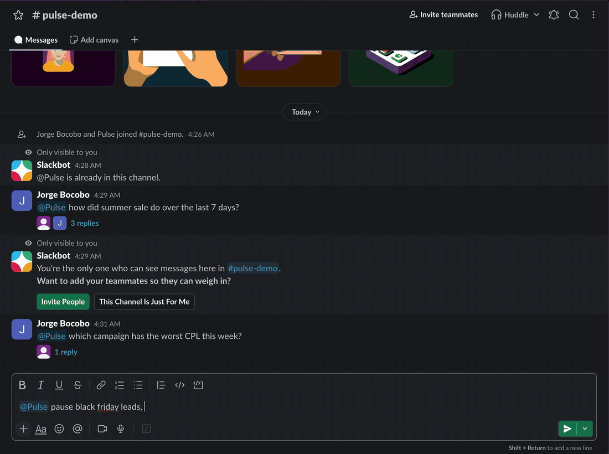
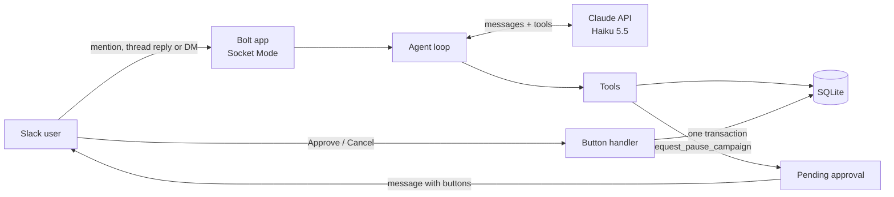

# Pulse

[](https://github.com/jorgebocobo9/pulse/actions/workflows/ci.yml)

A Slack assistant for a (fictional) performance marketing team, built on the Claude API. Ask it about campaign performance in plain English: Claude chooses the right tools, reads the numbers from a database and answers in the thread. Risky actions, such as pausing a campaign, never run on their own. Pulse posts an approval request, and nothing changes until a team lead clicks **Approve**.



*Asking Pulse to pause a campaign: it posts an approval request, a team lead approves it, and the action log shows the change (2.5× speed). The [full 2-minute walkthrough](docs/media/pulse-demo.mp4) also covers stats questions, thread follow-ups and an unknown campaign.*

All data is fake. Pulse never connects to a real ad account.

## What it shows

- **Tool use and an agent loop** written by hand against the Messages API, with Claude Haiku 5.5.
- **Human approval before any change**, with Slack buttons, an approver list, 30-minute expiry and an audit log.
- **Safety under duplicates and failures**: a double click acts once, a message Slack delivers twice is answered once, and tool errors and API errors never crash the bot.
- **Cost control**: a cheap model at low effort, a token cap, and a daily budget checked before every Claude call.
- **Evals**: 10 code-graded cases, 5 of them adversarial, run through the real agent.

| | |
|---|---|
| Typical answer | 3 to 5 seconds, about $0.0005 |
| Automated tests | 104 (vitest), run in CI with a secret scan |
| Evals | **30/30** (10 cases × 3 repetitions), all adversarial cases passing, $0.017 per run |

## Try it

```
@Pulse How did Summer Sale do over the last 7 days?
@Pulse Which campaign has the worst CPL this week?
@Pulse Pause Black Friday Leads, the CPL is too high.     → posts Approve / Cancel buttons
@Pulse What actions were taken today?
```

Follow-up replies in a Pulse thread don't need another mention, and you can also send Pulse a direct message.

## How it works



1. A message arrives. Pulse skips it if it was already handled, then loads the conversation history for that thread or DM.
2. The agent loop checks the daily budget, then calls Claude with the system prompt, the history and six tools.
3. Claude asks for tools, such as `get_campaign_stats` or `compare_campaigns`. Pulse validates each input with zod, runs it against SQLite and sends the results back. This repeats until Claude answers, up to 6 rounds.
4. If Claude used `request_pause_campaign` or `request_resume_campaign`, Pulse posts an approval request with **Approve** and **Cancel** buttons. The tool itself changes nothing.
5. When an approver clicks **Approve**, one database transaction claims the request, changes the campaign and writes the audit log entry.

### Design decisions

- **Approvals are data, not actions.** The request tools only insert a `pending` row. The change happens in the button handler, outside the model's reach, and the requester's identity comes from the Slack event, never from Claude's input.
- **Double clicks act once.** The request is claimed with `UPDATE approvals ... WHERE id = ? AND status = 'pending' AND expires_at > ?`. Only the first click updates a row; a second click, or a second approver, gets "Already approved by …".
- **A hand-written agent loop.** It needs a budget check before every call, a round limit that still answers every open tool call, and usage logging per response. It's about 150 lines in [`src/agent/loop.ts`](src/agent/loop.ts).
- **History that stays valid.** Haiku 5.5 ties its thinking blocks to the exact prompt and history that produced them. The system prompt never changes (today's date goes in the user message), stored history drops thinking blocks, and history is trimmed only where a user turn starts.
- **One schema per tool.** Each tool's zod schema validates Claude's input and generates the JSON Schema Claude sees, so the two can't drift apart.
- **Evals graded by code.** Expected numbers come from the database, not from a model, and graders check the end state (was an approval created? did the campaign change?) and claims the reply must not make. The first run caught Pulse reporting a "70% profit margin" from ad spend alone; a one-line prompt change fixed it.

## Setup

Requires Node.js 22 or newer, a Slack workspace you can add apps to, and an Anthropic API key.

1. **Install dependencies:** `npm install`
2. **Create the Slack app:** go to <https://api.slack.com/apps>, click **Create New App → From a manifest**, pick your workspace and paste [`slack-app-manifest.yaml`](slack-app-manifest.yaml).
3. **Get the Slack tokens:**
   - **Basic Information → App-Level Tokens:** generate a token with the `connections:write` scope. This is `SLACK_APP_TOKEN` (`xapp-…`).
   - **Install App:** install it to your workspace. The Bot User OAuth Token is `SLACK_BOT_TOKEN` (`xoxb-…`).
4. **Get an Anthropic API key** from the [Anthropic Console](https://console.anthropic.com), and set a monthly spend limit there.
5. **Find the approvers' Slack user IDs:** in Slack, open someone's profile → **⋮** → **Copy member ID**.
6. **Configure:** `cp .env.example .env` and fill in the values. `APPROVER_USER_IDS` is a comma-separated list.
7. **Load the demo data:** `npm run seed` creates 5 campaigns with 90 days of metrics ending today (UTC). Re-run it before a demo to refresh the numbers and campaign statuses; it never deletes approvals, the audit log or usage.
8. **Run:** `npm run dev`
9. **Try it:** in a public channel, run `/invite @Pulse`, then send `@Pulse How did Summer Sale do this week?`

| Variable | Purpose | Default |
|---|---|---|
| `SLACK_BOT_TOKEN`, `SLACK_APP_TOKEN` | Slack credentials | required |
| `ANTHROPIC_API_KEY` | Claude API key | required |
| `ANTHROPIC_MODEL` | Model ID (must have a price in `src/config.ts`) | `claude-haiku-5-5` |
| `APPROVER_USER_IDS` | Who can approve | required |
| `DAILY_BUDGET_USD` | Daily spend limit, UTC | `1` |
| `DATABASE_PATH` | SQLite file | `./data/pulse.db` |
| `LOG_LEVEL` | `debug` also logs message text | `info` |

## Scripts

| Command | What it does |
|---|---|
| `npm run dev` | Runs Pulse with auto-reload and readable logs |
| `npm start` | Runs Pulse |
| `npm run seed` | Loads or refreshes the demo campaign data |
| `npm test` | Runs the automated tests |
| `npm run typecheck` | Type-checks the project |
| `npm run eval` | Runs the eval cases against the Claude API (about $0.006; add `-- --reps 3` for repetitions) |
| `npm run smoke` | Runs two real turns against the API without Slack |

## Project structure

```
src/
  index.ts              starts the Slack app
  config.ts             validates environment variables, model prices
  agent/
    loop.ts             the agent loop
    tools.ts            tool definitions, validation and dispatch
    prompt.ts           system prompt
    history.ts          per-thread history: storage, trimming
  services/
    approvals.ts        create, approve, cancel, expire, action log
    budget.ts           usage logging and the daily budget
    dedupe.ts           skips messages Slack delivers twice
  slack/
    events.ts           mentions, thread replies and DMs
    actions.ts          Approve and Cancel buttons
    blocks.ts           Block Kit messages
    format.ts           Slack formatting helpers
  db/                   schema, client, queries, data generator, seed
evals/                  eval cases, graders and runner
tests/                  vitest tests
scripts/                seed and smoke scripts
```

The full spec is in [`slack-agent-PRD.md`](slack-agent-PRD.md), the guide for team members is [`SOP.md`](SOP.md), and the demo walkthrough is [`docs/DEMO.md`](docs/DEMO.md).

## Known limitations / what I'd do in production

These are deliberate cuts for a demo. Each is listed with what I'd do instead.

| Limitation | In production |
|---|---|
| Two messages sent quickly in the same thread can race, and one turn's history may overwrite the other's. | A per-conversation queue, or a lock in the database when running more than one instance. |
| An approver can approve their own request. | Block self-approval, so every change needs a second person. |
| Asking twice creates two pending requests. The second does nothing when approved, but it's noise. | Refuse a new request while one is pending for the same campaign and action. |
| An expired request keeps its buttons until someone clicks them. | A sweep every few minutes that marks requests expired and removes their buttons. |
| The duplicate-message table is never cleaned up. | Delete rows older than a week. |
| Demo data goes stale until `npm run seed` is re-run. | Not needed with real data; for the demo, refresh on startup. |
| SQLite and Socket Mode, one instance on one machine. | Postgres, HTTP mode behind a load balancer, several instances. |
| Fake data behind the action tools. | A real ad platform API, called with an idempotency key from the button handler. |
| Public channels only. | Add the `groups:history` scope and `message.groups` event. |

## License

MIT
